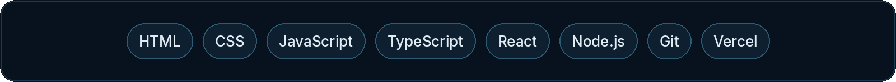
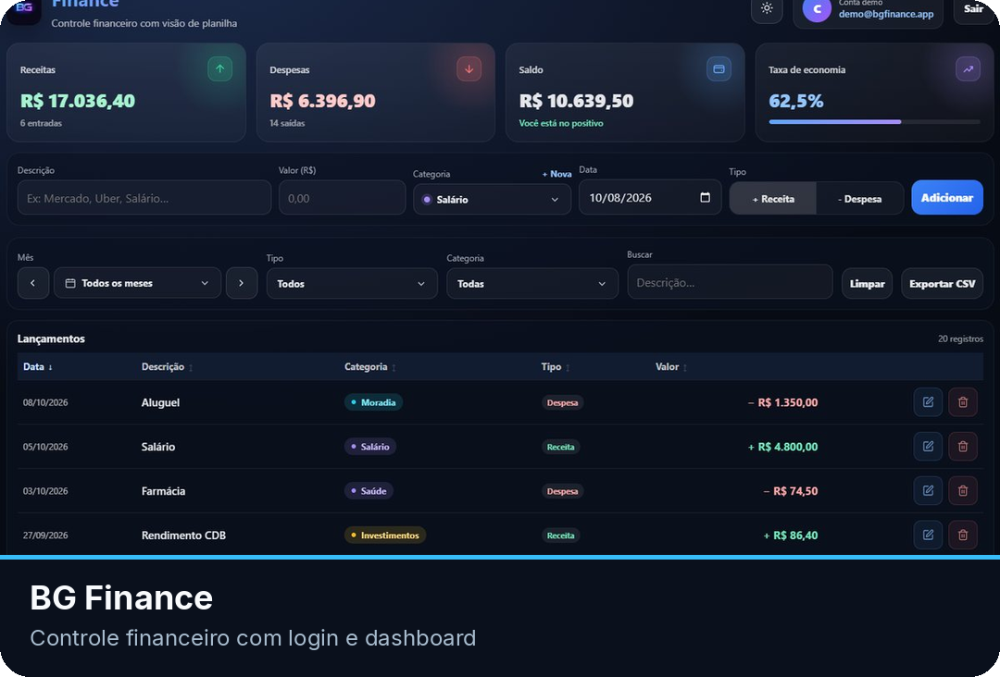
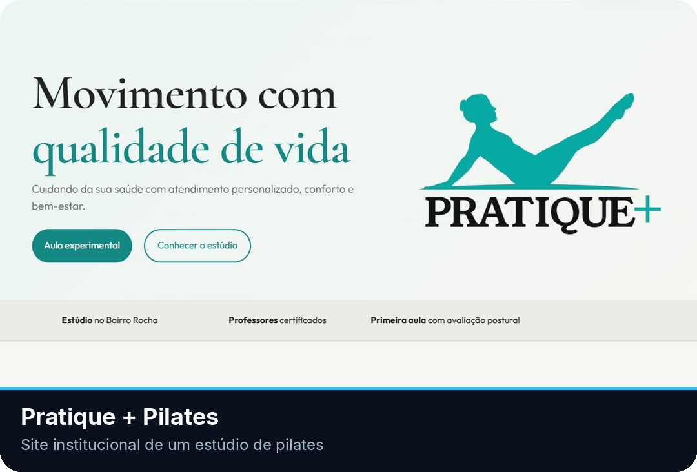
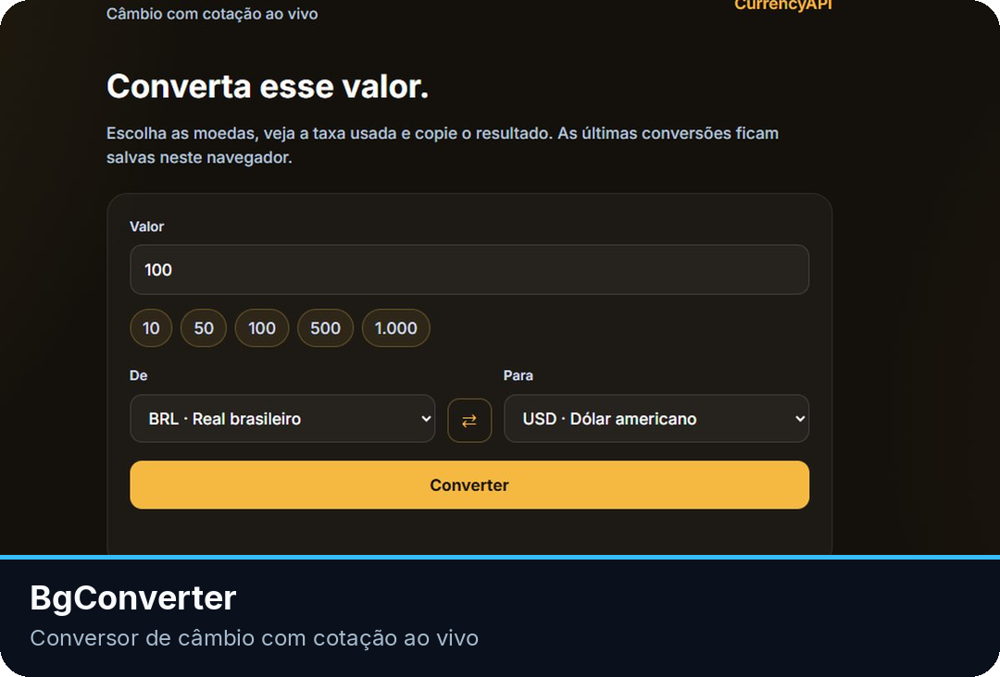
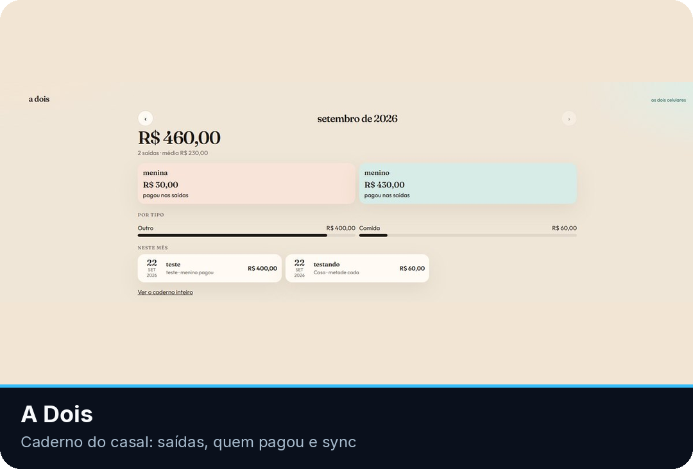
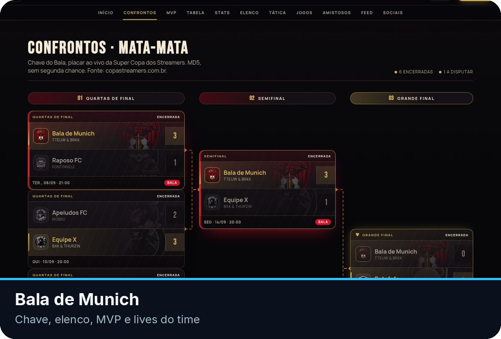
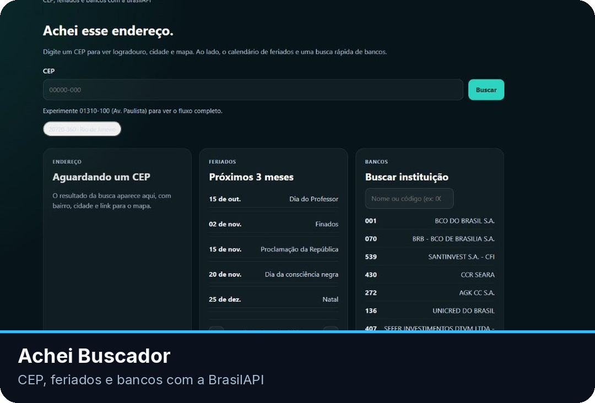

  

  
  &nbsp;
  
  &nbsp;
  
  &nbsp;
  
  &nbsp;
  

  

<h2 align="center">Projetos</h2>

<table>
  <tr>
    <td width="50%" valign="top">
      
      

        <a href="https://bg-finance.onrender.com/">Site</a>
        &nbsp;·&nbsp;
        <a href="https://github.com/kauanbg-dev/bg-finance">Código</a>
      

    </td>
    <td width="50%" valign="top">
      
      

        <a href="https://pratique-pilates.vercel.app/">Site</a>
        &nbsp;·&nbsp;
        <a href="https://github.com/kauanbg-dev/pratique-pilates">Código</a>
      

    </td>
  </tr>
  <tr>
    <td width="50%" valign="top">
      
      

        <a href="https://bgconverter.vercel.app/">Site</a>
        &nbsp;·&nbsp;
        <a href="https://github.com/kauanbg-dev/bgconverter">Código</a>
      

    </td>
    <td width="50%" valign="top">
      
      

        <a href="https://adois-chi.vercel.app/">Site</a>
        &nbsp;·&nbsp;
        <a href="https://github.com/kauanbg-dev/adois">Código</a>
      

    </td>
  </tr>
  <tr>
    <td width="50%" valign="top">
      
      

        <a href="https://balademunich.vercel.app/">Site</a>
        &nbsp;·&nbsp;
        <a href="https://github.com/kauanbg-dev/bala-de-munich">Código</a>
      

    </td>
    <td width="50%" valign="top">
      
      

        <a href="https://achei-buscador.vercel.app/">Site</a>
        &nbsp;·&nbsp;
        <a href="https://github.com/kauanbg-dev/achei-buscador">Código</a>
      

    </td>
  </tr>
</table>

  O restante está no <a href="https://portifolio-bgkauan.vercel.app/">portfólio</a>.

