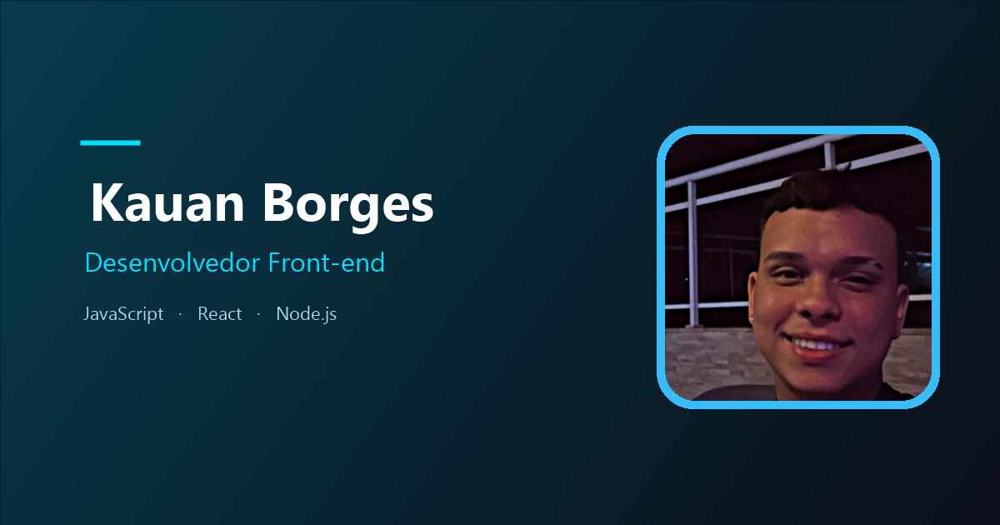
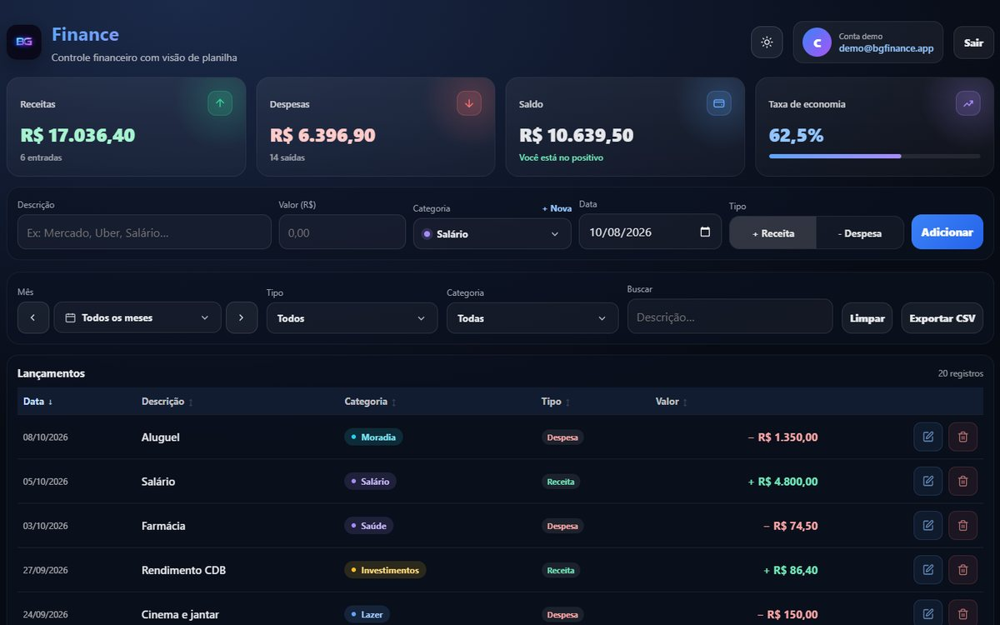
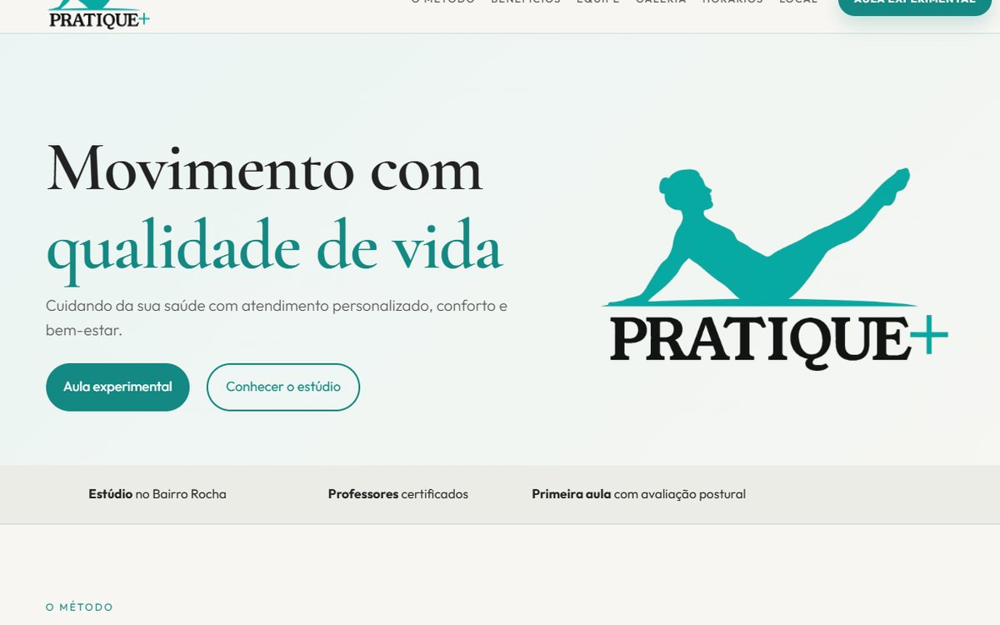
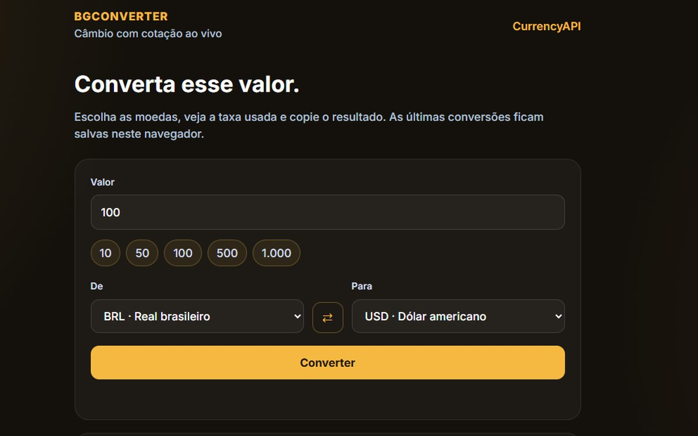
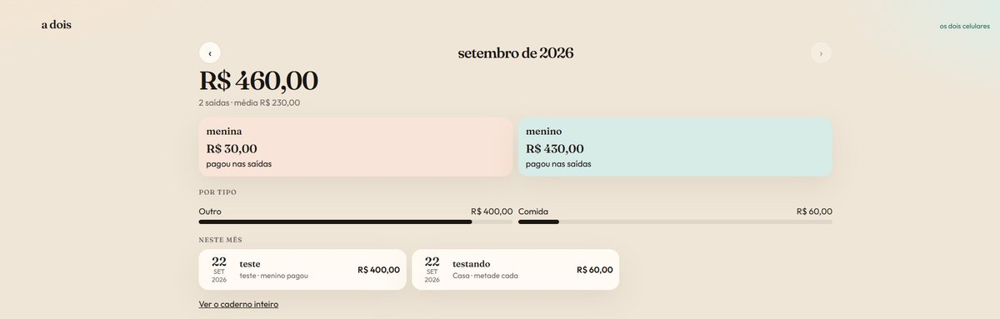
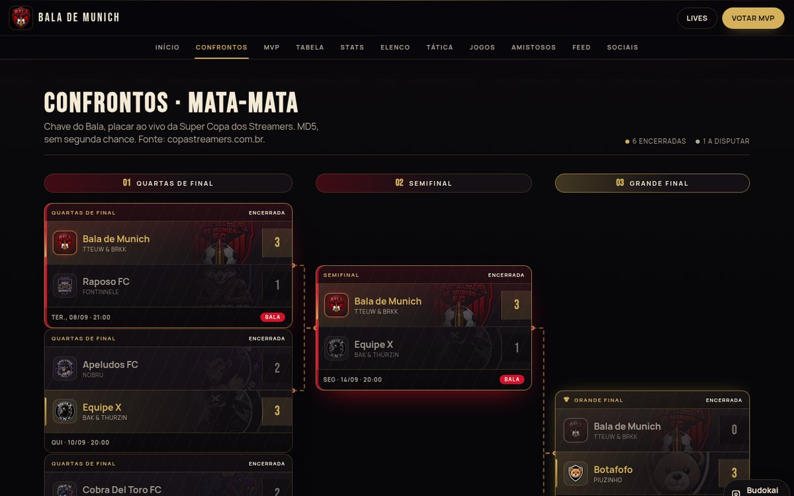
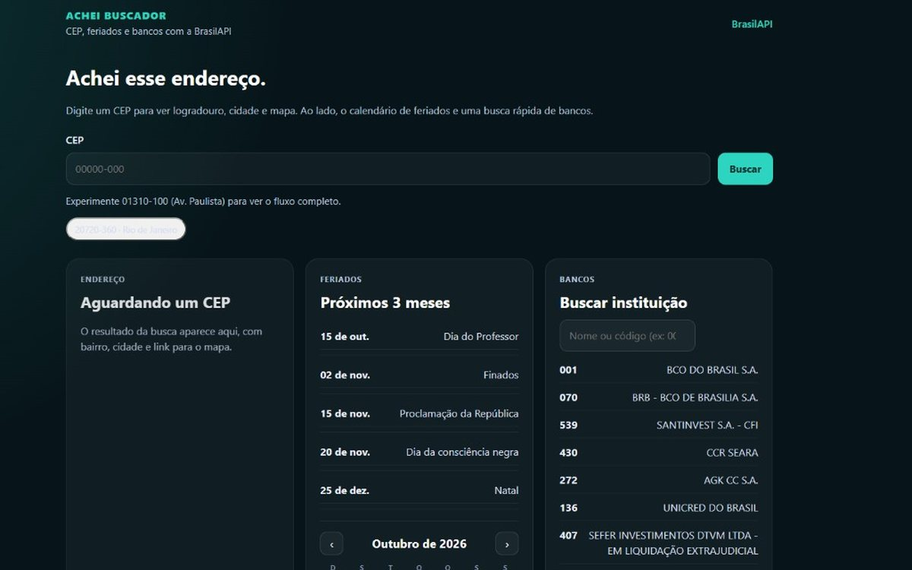

<!--
  README do perfil: github.com/kauanbg-dev
  O GitHub só mostra este arquivo na página do perfil se o repositório
  se chamar kauanbg-dev (kauanbg-dev/kauanbg-dev), branch main.
  As imagens ficam em assets/ e precisam ir junto neste mesmo repositório.
-->

  

  Rio de Janeiro, RJ · 5º período de Ciência da Computação 
  Estágio de TI na Prefeitura do Rio de Janeiro

  <a href="https://portifolio-bgkauan.vercel.app/">Portfólio</a>
  &nbsp;·&nbsp;
  <a href="https://www.linkedin.com/in/kauan-borges-079074370/">LinkedIn</a>
  &nbsp;·&nbsp;
  <a href="https://github.com/kauanbg-dev">GitHub</a>
  &nbsp;·&nbsp;
  <a href="https://www.instagram.com/eukauan.dev/">Instagram</a>
  &nbsp;·&nbsp;
  <a href="mailto:kauanbg.dev@gmail.com">kauanbg.dev@gmail.com</a>

Faço interfaces web responsivas, do layout ao deploy, com HTML, CSS, JavaScript, React e Node.js. Abaixo estão os projetos que estão no ar.

## Stack

  

  <code>HTML</code> · <code>CSS</code> · <code>JavaScript</code> · <code>TypeScript</code> · <code>React</code> · <code>Node.js</code> · <code>Git</code> · <code>Vercel</code>

## Projetos

<table>
  <tr>
    <td width="50%" valign="top">
      
       
      <strong><a href="https://github.com/kauanbg-dev/bg-finance">BG Finance</a></strong>
       
      Controle financeiro com login e dashboard.
       
      <a href="https://bg-finance.onrender.com/">Site</a>
      &nbsp;·&nbsp;
      <a href="https://github.com/kauanbg-dev/bg-finance">Código</a>
    </td>
    <td width="50%" valign="top">
      
       
      <strong><a href="https://github.com/kauanbg-dev/pratique-pilates">Pratique + Pilates</a></strong>
       
      Site institucional de estúdio de pilates.
       
      <a href="https://pratique-pilates.vercel.app/">Site</a>
      &nbsp;·&nbsp;
      <a href="https://github.com/kauanbg-dev/pratique-pilates">Código</a>
    </td>
  </tr>
  <tr>
    <td width="50%" valign="top">
      
       
      <strong><a href="https://github.com/kauanbg-dev/bgconverter">BgConverter</a></strong>
       
      Conversor de câmbio com cotação ao vivo.
       
      <a href="https://bgconverter.vercel.app/">Site</a>
      &nbsp;·&nbsp;
      <a href="https://github.com/kauanbg-dev/bgconverter">Código</a>
    </td>
    <td width="50%" valign="top">
      
       
      <strong><a href="https://github.com/kauanbg-dev/adois">A Dois</a></strong>
       
      Caderno do casal: saídas, quem pagou e sync nos celulares.
       
      <a href="https://adois-chi.vercel.app/">Site</a>
      &nbsp;·&nbsp;
      <a href="https://github.com/kauanbg-dev/adois">Código</a>
    </td>
  </tr>
  <tr>
    <td width="50%" valign="top">
      
       
      <strong><a href="https://github.com/kauanbg-dev/bala-de-munich">Bala de Munich</a></strong>
       
      Site do time na Super Copa dos Streamers: elenco, chave, MVP e lives.
       
      <a href="https://balademunich.vercel.app/">Site</a>
      &nbsp;·&nbsp;
      <a href="https://github.com/kauanbg-dev/bala-de-munich">Código</a>
    </td>
    <td width="50%" valign="top">
      
       
      <strong><a href="https://github.com/kauanbg-dev/achei-buscador">Achei Buscador</a></strong>
       
      CEP, feriados e bancos com React e BrasilAPI.
       
      <a href="https://achei-buscador.vercel.app/">Site</a>
      &nbsp;·&nbsp;
      <a href="https://github.com/kauanbg-dev/achei-buscador">Código</a>
    </td>
  </tr>
</table>

  O restante do trabalho está no <a href="https://portifolio-bgkauan.vercel.app/">portfólio</a>.

## Contato

- E-mail: [kauanbg.dev@gmail.com](mailto:kauanbg.dev@gmail.com)
- LinkedIn: [kauan-borges](https://www.linkedin.com/in/kauan-borges-079074370/)
- Instagram: [eukauan.dev](https://www.instagram.com/eukauan.dev/)
- GitHub: [kauanbg-dev](https://github.com/kauanbg-dev)
